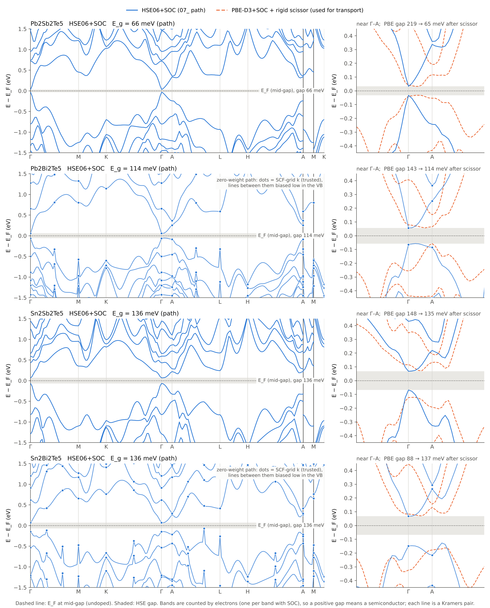

# 带边 s 占比与 Seebeck（p 型、n 型分开）

只用仓库里已有的 SOC 密网格结果做后处理，**没有运行新的 DFT**。用到的数据：`EIGENVAL`（28×28×7，Bi 系 28×28×6）、BoltzTraP2 常数弛豫时间结果、17_ 的密网格 PROCAR s 占比。

```bash
python 10_脚本/seebeck_mass.py . --dense-s 17_密网格PROCAR_s占比_DeepSeek/密网格_s占比_全温度全浓度.csv   # 同浓度对比，约 5 s
python 10_脚本/s_vs_n.py .                                                                             # 低浓度与本征区，约 3 s
python 10_脚本/bt2_local.py . Pb2Sb2Te5                                                                # 本地重做 BoltzTraP2：带隙敏感性（每个材料约 5 min，峰值内存约 10 GB）
python 10_脚本/edge_s_by_k.py analyze .                                                                # 逐 k 投影（读 逐k投影/*.npz）
```

## 1 方法

- **为什么不直接比 S**：S 同时取决于载流子浓度和能带。所以先在同一浓度下比较，并用单抛物带模型把 S 反解成 **Seebeck 有效质量 m\*_S**（与浓度无关）。另外两个独立的量：由 n(μ) 反解的**态密度质量 m\*_D**；在全网格上直接数出来的**有效谷数** N_v,eff = Σ 重数 × e^(−ΔE/kT)。谷数不是从 m\* 反推的。
- **化学势零点**：BoltzTraP2 的 μ 以剪刀修正后的带隙中点为零点。
- **方向**：取面内 S =（S_xx + S_yy）/2。
- **s 占比**：用 PBE+SOC 密网格 PROCAR，在相同的浓度和温度下按 −∂f/∂E 加权，分成 A-s、B-s、Te-s。
- **浓度**：本页所有浓度都是**净**浓度（空穴数减电子数）。

## 2 同浓度对比（300 K，面内，≥3e19）

| 材料 | 边 | s 占比 %（A / B / Te），3e19 | N_v,eff | S @3e19（µV/K） | m\*_S | m\*_D | S @1e20（µV/K） |
|---|---|---|---:|---:|---:|---:|---:|
| Pb₂Sb₂Te₅ | 价带 | 7.6 / 9.0 / 4.0 | 12.0 | 203 | 0.95 | 1.26 | 120 |
| Pb₂Bi₂Te₅ | 价带 | 9.5 / 4.7 / 3.1 | 6.5 | 208 | 0.99 | 0.94 | 121 |
| Sn₂Sb₂Te₅ | 价带 | 16.7 / 7.7 / 3.3 | 11.8 | 201 | 0.93 | 0.88 | 113 |
| Sn₂Bi₂Te₅ | 价带 | 17.9 / 4.8 / 3.1 | 7.8 | 201 | 0.94 | 0.91 | 122 |
| Pb₂Sb₂Te₅ | 导带 | 2.0 / 4.1 / 8.8 | 2.0 | −123 | 0.45 | 0.47 | −91 |
| Pb₂Bi₂Te₅ | 导带 | 2.8 / 4.9 / 4.9 | 2.0 | −125 | 0.46 | 0.45 | −83 |
| Sn₂Sb₂Te₅ | 导带 | 3.2 / 3.6 / 7.6 | 4.9 | −158 | 0.63 | 0.84 | −95 |
| Sn₂Bi₂Te₅ | 导带 | 4.0 / 4.8 / 3.8 | 4.0 | −182 | 0.79 | 1.10 | −93 |

质量单位为 mₑ，m\*_S 按常数弛豫时间反解。

**带边的能谷**（`有效质量_能谷_汇总.json`，100 meV 以内，ΔE 为相对带边的能量）：

| 材料 | 价带 | 导带 |
|---|---|---|
| Pb₂Sb₂Te₅ | 2 个在 Γ–A 轴（kz = 1/7）；12 重一组，ΔE = 4.7 meV | 2 个在 Γ–A 轴 |
| Pb₂Bi₂Te₅ | 1 个在 A 点；12 重一组，ΔE = 20.4 meV | 2 个在 Γ–A 轴 |
| Sn₂Sb₂Te₅ | 6 重；12 重，ΔE = 19.8 meV；2 重，ΔE = 53 meV | 4 重，偏离 Γ–A 轴一个网格步长；2 重，ΔE = 21.6 meV |
| Sn₂Bi₂Te₅ | 6 重；6 重，ΔE = 31.6 meV | 4 重，偏离 Γ–A 轴一个网格步长 |

**读法**

- **p 型**：同浓度下四种材料的 S 几乎相同，m\*_S 为 0.93–0.99 mₑ。
  - 价带顶的 s 成分在 A、B 两个位置都是 6s 比 5s 少：Pb-s（7.6–9.5%）低于 Sn-s（16.7–17.9%），Bi-s（4.7–4.8%）低于 Sb-s（7.7–9.0%）。
  - 价带的谷结构随 B 位变化：Sb 系那组 12 重谷离价带顶只有 5–20 meV，Bi 系为 20–30 meV。但单谷质量的差别把谷数的差别补平了，所以 S 不随材料变化。
  - 结论：**带边 s 占比不决定 p 型 S**。
- **n 型**：S 按 A 位分组，Sn 系 |S| 比 Pb 系高 25–45%（3e19），到 1e20 时差别消失。
  - Sn 系导带底偏离 Γ–A 轴，很可能是绕轴一圈的环状极小，在网格上被采成 4 个点。环状带边使态密度质量变大（0.84–1.10 对 0.45–0.47），这是 |S| 更高的原因。“4–5 个谷”这个数依赖网格，环的半径需要用更密的局部网格确认。
  - 导带底的 s 成分四种材料相近（总 s 12.6–14.9%，A-s 只有 2–4%），**也不是 s 占比造成的**。
- “6s 比 5s 更惰性”和“6p 的自旋轨道耦合更强”都来自相对论效应，在这个 2×2 体系里混在一起。要区分两者，需要无 SOC 的对照（19_ 计算 1-6）。
- **Pb₂Sb₂Te₅ 在 Γ 点的带序**（`逐k投影/Pb2Sb2Te5.npz`）：
  - PBE 下，Γ 点最高价带几乎是纯 Te-p（A-s 0.43%）；阳离子 s 成分高的态（A-s 9.4%、B-s 14.8%）在 Γ 点导带，比价带顶高约 230 meV。
  - HSE 下，Γ 点价带顶是阳离子 s 与 Te-p 的混合态，带隙只有 0.065 eV。
  - 两种泛函给出的 s–p 带序不同，说明阳离子 s 能级与 Te-p 能级接近反转，刚性剪刀修正纠正不了。所以 PbSb 在 Γ 附近的结果，以及下一节的低浓度结果，都要谨慎对待。

## 3 低浓度与本征区（`低浓度特征量.csv`、`S随净浓度_300K_500K.csv`）

带隙只有 0.065–0.137 eV，300 K 时本征载流子浓度已达 10¹⁸ 量级。低于这个浓度时，S 不再由单一载流子决定，而由带隙以及价带、导带的不对称决定。

**300 K 面内 S（µV/K）**

| 净浓度 | p 型：PbSb / PbBi / SnSb / SnBi | n 型：PbSb / PbBi / SnSb / SnBi |
|---|---|---|
| 1e17 | +89 / +147 / +188 / +198 | +83 / +122 / +166 / +185 |
| 3e17 | +95 / +171 / +209 / +211 | +77 / +96 / +144 / +170 |
| 1e18 | +114 / +242 / +263 / +252 | +57 / +9 / +60 / +109 |
| 3e18 | +160 / +319 / +320 / +299 | +1 / −144 / −123 / −54 |
| 1e19 | +227 / +289 / +283 / +275 | −112 / −176 / −215 / −222 |
| 3e19 | +203 / +208 / +201 / +202 | −123 / −126 / −158 / −182 |

**特征量**

| | PbSb | PbBi | SnSb | SnBi |
|---|---:|---:|---:|---:|
| 带隙（eV，剪刀修正后） | 0.065 | 0.114 | 0.135 | 0.137 |
| 本征载流子浓度 n_i，300 K（cm⁻³，BoltzTraP2） | 4.0e18 | 1.2e18 | 1.3e18 | 1.7e18 |
| 净浓度为 0 时的 S，300 K（µV/K） | +86 | +135 | +177 | +191 |
| n 型 S 变为负值所需的净电子浓度，300 K / 500 K | 3.0e18 / 9.2e18 | 1.1e18 / 6.0e18 | 1.5e18 / 1.1e19 | 2.3e18 / 1.3e19 |
| p 型 S 最大值，300 K（µV/K，出现浓度） | 231（1.3e19） | 324（4.2e18） | 323（3.4e18） | 303（4.8e18） |
| n 型 \|S\| 最大值，300 K（µV/K，出现浓度） | 133（1.8e19） | 185（5.7e18） | 218（8.6e18） | 223（1.0e19） |

**读法**

- **p 型**：S 有上限，峰值出现在 3e18–1e19；浓度再低，少数载流子增多，S 反而下降。峰值高低与带隙顺序一致，PbSb 最低（231），另外三种在 300–324。这是“s 能级位置 → 带隙 → S”在低浓度下的体现。S 的峰值不等于功率因子最优浓度，后者还取决于电导率，要看 AMSET 的功率因子。
- **n 型**比 p 型脆弱得多。本征状态（净浓度为 0）下四种材料的 S 都是**正的**（+86 到 +191），所以净电子浓度低于约 1–3e18（300 K）时 S 仍为正。原因是价带谷多、态密度大，空穴的 Seebeck 系数大，电导质量又比电子轻（0.08–0.10 对 0.11–0.24 mₑ）。
- **对问题二的意义**：Seebeck 系数的正负不等于净载流子类型。要在 300 K 测出负的 S，净电子浓度至少要超过 1.1e18（PbBi）到 3.0e18（PbSb）；500 K 时要超过约 1e19。
- **注意**：
  - 这里是常数弛豫时间近似。密网格 AMSET 给出 SnSb 空穴迁移率约为电子的 2.6 倍，考虑真实散射后空穴的作用更大，n 型变号阈值只会更高。
  - 3e18 以下的数值对带隙非常敏感，PbSb 的带隙本身就不可靠（见第 2 节带序）。带隙敏感性见下一小节。
  - S 是在化学势上插值得到的（化学势网格步长 8 meV）。1e19–1e20 的值与 `有效质量_Seebeck.csv` 相差不到 1 µV/K。

### 3.1 带隙敏感性（`剪刀敏感性_300K.csv`，300 K）

用 [`10_脚本/bt2_local.py`](../10_脚本/bt2_local.py) 从密网格 EIGENVAL 在本地重做 BoltzTraP2，只拟合带隙 ±3 eV 内的能带，其余设置与集群相同。
- **复现核对**（`本地BoltzTraP2复现核对.csv`）：同一化学势下，与集群结果的 S 相差 3.6–8.7 µV/K。
- **做法**：插值只做一次，再把导带整体平移到不同带隙。拟合对能量是线性的，所以这和先加剪刀再插值完全等价。

| 材料 | 带隙（eV） | p 型 S 最大值（µV/K） | n 型 S 变负所需净电子浓度 | S @p 3e19 | S @n 3e19 | S @p 1e20 |
|---|---|---|---|---|---|---|
| PbSb | 0.030 / **0.065** / 0.115 / 0.165 | 191 / **235** / 302 / 374 | 6.1e18 / **2.9e18** / 9.7e17 / 3.2e17 | 186 / **204** / 212 / 214 | −108 / **−125** / −131 / −133 | 119 / **121** / 121 / 121 |
| PbBi | 0.079 / **0.114** / 0.164 / 0.214 | 277 / **326** / 400 / 474 | 2.3e18 / **1.1e18** / 3.9e17 / 1.4e17 | 206 / **208** / 209 / 209 | −126 / **−128** / −129 / −129 | 122 / **122** / 122 / 122 |
| SnSb | 0.100 / **0.135** / 0.185 / 0.235 | 278 / **327** / 400 / 476 | 3.1e18 / **1.5e18** / 5.3e17 / 1.9e17 | 201 / **202** / 203 / 203 | −152 / **−159** / −161 / −162 | 115 / **115** / 115 / 115 |
| SnBi | 0.102 / **0.137** / 0.187 / 0.237 | 264 / **312** / 384 / 460 | 4.5e18 / **2.2e18** / 8.4e17 / 3.1e17 | 201 / **204** / 204 / 204 | −173 / **−186** / −190 / −191 | 122 / **122** / 122 / 122 |

粗体为现用带隙（HSE+SOC 路径值）。

- **高浓度的结论基本不受带隙影响**：p 型 1e20 的 S 随带隙变化不超过 1 µV/K；3e19 时 PbBi、SnSb、SnBi 不超过 3 µV/K，PbSb 在 186–214 之间（相对现用值 −9% 到 +5%）。所以第 2 节“同浓度下 p 型 S 与材料无关”是稳健的。n 型 3e19 的 S 变化在 15% 以内，PbSb 最大。
- **低浓度的结论几乎完全由带隙决定**：
  - p 型 S 最大值基本只随带隙变化，四种材料落在同一条线上：带隙 0.11–0.14 eV 时为 300–330 µV/K，0.16–0.19 eV 时为 375–400 µV/K。
  - PbSb 的 S 最大值偏低，完全是因为它的带隙最小；把它的带隙设成 0.115 eV，结果（302）就和其他三种相当。
  - 带隙每增加 0.05 eV，n 型变号阈值降低约 2–3 倍。
- **所以，低浓度、高温和双极效应的结论能不能成立，取决于带隙是否可靠。** 现用带隙来自 HSE 能带路径，而 PbSb 的 PBE 带隙（0.219 eV）反而是四种中最大的。19_ 的计算 1-8 用来确定带隙。

### 3.2 刚性剪刀不成立：HSE 改变的是 Γ 附近的能带形状（`HSE与PBE同k点能带对照.csv`）

[`10_脚本/hse_pbe_bandshape.py`](../10_脚本/hse_pbe_bandshape.py) 把 07_ 的 HSE06+SOC 能带路径与 PBE-D3+SOC 密网格放在两者共有的 k 点上比较：TRIM 点，Sb 系还有 Γ–A 线上的 kz = 1/7、2/7、3/7。没有新的 DFT。



线状能带图由 [`10_脚本/band_lines.py`](../10_脚本/band_lines.py) 生成。能量零点取本征费米能级，即未掺杂时的带隙中点；掺杂会使 E_F 移向带边，输运计算中是扫描 E_F 的。左栏是 HSE 全路径；右栏是 Γ–A 附近的放大图，对比 HSE 与输运实际使用的 PBE+剪刀能带，两者各自以带隙中点为零。能带按电子数分配（SOC 下每条带 1 个电子），所以带隙为正就是半导体；四种材料都是窄带隙半导体，不是金属。

**HSE 设置本身没有问题**：HSE06（AEXX 0.25、HFSCREEN 0.2）+ SOC，PREC=Accurate，ENCUT 与 PBE 相同，Γ 中心 12×12×2 自洽网格（包含全部 8 个 TRIM 点），能带用 KPOINTS_OPT 算；PbSb、SnSb、SnBi 与 PBE 是同一个结构。小问题有三个：`PRECFOCK=Fast`；PbBi 用的是略有不同的晶胞；带隙是路径上的最小值，而 Sn 系的 PBE 带边不在路径上，所以 Sn 系真实的 HSE 带隙可能更小。

**Bi 系的 HSE 能带路径有计算缺陷**：PbSb、SnSb 的路径用 KPOINTS_OPT 计算，能带是光滑的。PbBi、SnBi 则是把路径作为零权重 k 点并入自洽计算，结果在每个 12×12×2 自洽网格点上都出现尖峰：价带在网格点上的能量比相邻路径点高 0.1–0.5 eV（价带二阶差分在网格点上的中位数为 124–161 meV，在其他点上只有 6–7 meV）；导带只差约 50 meV 以内。网格点上的值与自洽计算本身一致，是可信的；网格点之间的价带整体偏低。所以：
- 第 3.2 节的对比表只用了网格点（Bi 系）和 KPOINTS_OPT 路径（Sb 系），不受影响；
- 但 Bi 系的 HSE 带隙（0.114、0.136 eV，即现用的剪刀目标值）和 HSE 价带形状不可靠。SnBi 的 HSE 价带顶正好落在网格点 (1/3, 0, 1/2) 上，真实价带顶可能在网格点之间、位置更高，因此真实带隙可能更小；
- Bi 系的 HSE 要按 Sb 系的做法（KPOINTS_OPT）在当前结构上重算，见 19_ 计算 1-0。

**问题在于用法**：把 HSE 只当成一个带隙数，对 PBE 能带做刚性剪刀。同一 k 点上，HSE 带隙减 PBE 带隙随 k 变化很大：

| 材料 | 在 Γ | 在 Γ–A 线 / A 点 | M、L 点 | 刚性剪刀用的值 |
|---|---:|---:|---:|---:|
| PbSb | −166 | −41（1/7）、+116（2/7）、+209（3/7） | +577 到 +666 | −154 |
| PbBi | −244 | +187（A） | +185 到 +336 | −29 |
| SnSb | −116 | −46（1/7）、+87（2/7）、+179（3/7） | +430 到 +555 | −13 |
| SnBi | −143 | +220（A） | +20 到 +142 | +48 |

（单位 meV）

- **四种材料在 Γ 点都是 HSE 带隙更小**，离开 Γ 则 HSE 带隙更大。正常情况下杂化泛函会让带隙普遍变大；只在 Γ 点变小，最可能的原因是 PBE+SOC 在 Γ 点发生了能带反转（与 Bi₂Te₃、Sb₂Te₃ 同类），HSE 削弱或消除了这个反转。要用 TRIM 点的宇称来确认（19_ 计算 1-0）。
- **带边位置和形状随之改变**：
  - HSE 的导带底在四种材料中都在 Γ 点，PbSb、SnSb 的价带顶也在 Γ 点。
  - PBE 的带边都不在 Γ 点：PbSb 在 Γ–A 线上 kz = 1/7 处；PbBi 价带顶在 A 点（Γ 点低 199 meV）；Sn 系在一般 k 点，导带底呈环状。
  - 例如 PbSb 沿 Γ–A 方向，HSE 价带从带顶下降 57 / 137 / 201 meV（kz = 1/7、2/7、3/7），PBE 只下降 0 / 1 / 19 meV。也就是说，PBE 价带沿 c 轴几乎是平的，HSE 则是色散很强的单谷。
- **受影响的结论**（都建立在 PBE 带边形状上）：
  - 第 2 节的能谷结构、N_v,eff、m\*_S、m\*_D，包括“Sn 系导带呈环状，所以 n 型 |S| 更高”；
  - 第 3 节的低浓度 S、变号阈值和双极项；
  - 14_ 的电导质量和迁移率；
  - 15_ λ 扫描中的谷数变化。
- **不受影响或只是定性的结论**：
  - POP 散射占主导；
  - Lorenz 数偏高来自双极热导，这是机理层面的结论；
  - 15_ 的回中能量（只涉及总能）；
  - 13_ 的缺陷化学。
- **怎么补**：见 19_ 的计算 1-0。先用宇称确认能带是否反转；再找一个在带边附近能复现 HSE 的密网格能带，替换 PBE 能带重做输运。这一步优先于其他所有能带相关的计算。

## 4 文件

- `有效质量_Seebeck.csv`：材料 × 温度（300/500/700 K）× 载流子 × 浓度（1e19、3e19、1e20）的 S（标量、面内、zz）、η、m\*_D、两种口径的 m\*_S、少数载流子比例、s 占比。
- `s占比_有效质量对照表.csv`：300 K 对照总表。
- `有效质量_能谷_汇总.json`：能谷星（ΔE、重数、k 点）、N_v,eff、电中性点、相关系数（只有 4 个材料，仅作描述）。
- `S随净浓度_300K_500K.csv`、`低浓度特征量.csv`：第 3 节。`低浓度特征量.csv` 里的 n_i 是在原始网格上按占据数估计的，会高估轻质量口袋，偏大；正文用 BoltzTraP2 插值后的值。
- `剪刀敏感性_300K.csv`、`本地BoltzTraP2复现核对.csv`：第 3.1 节。
- `s占比_Seebeck有效质量.png/.svg`：a 为 Pisarenko 曲线，b、c 为 m\*_S、m\*_D 与总 s 的关系。
- `逐k投影/*.npz`、`能谷分辨s占比.csv`、`同k点_PBE对HSE.csv`：带边 8 条带的逐 k 投影，以及由它得到的各谷 s 占比和 PBE/HSE 同 k 点对照。
- `HSE与PBE同k点能带对照.csv`：第 3.2 节，HSE 路径与 PBE 密网格共有 k 点上的带边能量和带隙。
- `能带线图_HSE与PBE.png/.svg/.json`：第 3.2 节的线状能带图，以及每个材料的 HSE 带隙、带边 k 点、Γ 和 A 点的带边能量。

**限制**：常数弛豫时间不含材料间散射差异（散射见 14_）；剪刀修正为刚性，而第 3.2 节表明 HSE 与 PBE 在 Γ 附近的能带形状不同，刚性剪刀不成立；能谷能量取网格点的值；四个材料构不成统计；s 投影不等于孤对电子数。
