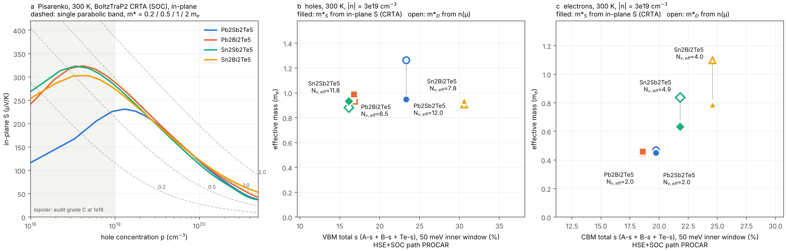

# 带边 s 占比与 Seebeck：用 Seebeck 有效质量连接

2026-10-18。只用仓库内已有的 SOC 密网格 `EIGENVAL`、BoltzTraP2 `boltztrap_crta.json`、`07_带边能窗` 和续算审计分级做后处理，**没有运行新的 DFT**。脚本：[`10_脚本/seebeck_mass.py`](../10_脚本/seebeck_mass.py)。

```bash
python 10_脚本/seebeck_mass.py .        # 约 5 s；重写本目录的 CSV/JSON/图
```

## 1 为什么要换一个参数

实验 S 的大小同时取决于载流子浓度和能带。直接把“s 占比”和“实验 S”放在一起比，会把掺杂差异误当作轨道效应。在单抛物带（SPB）模型下，S 由约化费米能 η 决定，n 由 η 与有效质量 m* 共同决定。所以只要同时测得 S 和霍尔浓度 n_H，就能反解出一个与浓度无关的量，即 **Seebeck 有效质量 m\*_S**：

- 实验：`(S, n_H, T)` → η → m\*_S，采用声学声子散射，τ∝E^−1/2，也就是 Snyder 等人的常用口径。
- 计算：对 BoltzTraP2 在固定浓度下的 S，用同一公式反解 m\*_S。表中同时给出常数 τ（与 CRTA 一致）和声学声子两种口径。实验对比时用声学声子口径。
- 独立核对：由 BoltzTraP2 的 n(μ) 和密网格带边反解 **态密度质量 m\*_D**；再在全网格上数能谷，得到 N_v,eff = Σ 重数·e^(−ΔE/kT)。

这样证据链就变成：s 占比 →（s–p 反键使带边变平或多谷）→ m\*_D、N_v → m\*_S → 同浓度下的 S。每一步都可以单独检验。旧的 5×5×5 局部 Hessian 质量多数没有覆盖真实极值（见审计第 3 节），这里不再使用；m\*_D 和 m\*_S 都是对全布里渊区积分得到的量。

## 2 这次修正的口径

1. **μ 零点**：BoltzTraP2 的 `mu_rel_efermi_eV` 以剪刀修正后的带隙中点为零点，即 E − E_VBM = μ + gap/2（审计 4.2 节），不是 OUTCAR 费米能。
2. **中隙浓度不为零是物理现象**：c(μ)=0 的点相对带隙中点的偏移，在 BoltzTraP2 中为 +23.2 / +14.6 / +0.1 / −5.5 meV（PbSb / PbBi / SnSb / SnBi，300 K）。在原始网格上独立求电中性点，得到 +24.9 / +16.4 / +3.6 / −1.6 meV。两者一致，说明审计 4.3 节的 c(μ=0)≠0 来自价带与导带 DOS 不对称，不是程序错误。正式报浓度点时仍应采用审计的 A/B/C 分级。
3. **面内 S**：层状薄膜一般测面内，所以主图和 m\*_S 都用 (S_xx+S_yy)/2。三方向平均值也保留在 CSV 里。
4. **总 s**：s 占比同时给出 A-s、B-s、Te-s 和总 s。窗口是带边内侧，VBM 取 VBM−50 meV 到 VBM，CBM 取 CBM 到 CBM+50 meV。

## 3 结果（300 K，BoltzTraP2 CRTA，面内）

| 材料 | 边 | 总 s %（A/B/Te） | N_v,eff | S @3e19 µV/K | m\*_S | m\*_D | S @1e20（审计级） | m\*_S | m\*_D |
|---|---|---|---:|---:|---:|---:|---|---:|---:|
| Pb₂Sb₂Te₅ | VBM | 23.3（7.3/9.6/6.4） | 12.0 | 203 | 0.95 | 1.26 | 120（A） | 0.97 | 1.27 |
| Pb₂Bi₂Te₅ | VBM | 16.8（2.6/6.9/7.3） | 6.5 | 208 | 0.99 | 0.94 | 121（A） | 0.98 | 1.05 |
| Sn₂Sb₂Te₅ | VBM | 16.1（3.6/2.6/9.9） | 11.8 | 201 | 0.93 | 0.88 | 113（A） | 0.90 | 0.96 |
| Sn₂Bi₂Te₅ | VBM | 30.6（23.1/5.4/2.1） | 7.8 | 201 | 0.94 | 0.91 | 122（A） | 0.99 | 1.01 |
| Pb₂Sb₂Te₅ | CBM | 19.7 | 2.0 | −123 | 0.45 | 0.47 | −91（A） | 0.70 | 0.55 |
| Pb₂Bi₂Te₅ | CBM | 18.6 | 2.0 | −125 | 0.46 | 0.45 | −83（A） | 0.62 | 0.52 |
| Sn₂Sb₂Te₅ | CBM | 21.8 | 4.9 | −158 | 0.63 | 0.84 | −95（A） | 0.73 | 0.86 |
| Sn₂Bi₂Te₅ | CBM | 24.6 | 4.0 | −182 | 0.79 | 1.10 | −93（A） | 0.71 | 1.00 |

质量单位为 mₑ；m\*_S 为常数 τ 口径。声学声子口径的 m\*_S 约大 1.4 倍，见 `s占比_有效质量对照表.csv` 的 `mS_APS_*` 列。3e19 不在审计的分级点中；1e19 的 p 型 Pb₂Sb₂Te₅ 受窄隙双极影响（m\*_S 0.56 对 m\*_D 1.17），解读时需注意。



**读法**

- **p 型**：在相同空穴浓度下，四种材料的计算 S 几乎相同（3e19 时 201–208 µV/K，1e20 时 113–122 µV/K）。m\*_S 也都在 0.93–0.99 mₑ 之间。但 VBM 总 s 占比从 16% 变到 31%，能谷结构也不同：Pb₂Bi₂Te₅ 只有 A 点 1 个谷，20 meV 内另有 12 个；Pb₂Sb₂Te₅ 在 5 meV 内有 14 个口袋。能谷数与单谷质量的差异相互抵消，m\*_D 接近。**所以在这套计算里，VBM 的 s 占比不会转化成同浓度下的 S 差别。** 如果 p 型样品的实验 S 差别很大，首先要怀疑载流子浓度（也就是缺陷化学，B 部分），其次是散射或双极效应，而不是带边 s 成分。
- **n 型**：Sn 系导带有 4–5 个等效谷，m\*_D 为 0.84–1.10；Pb 系只有 2 个谷，m\*_D 约 0.46。Sn 系的 CBM 总 s 占比也更高（21.8–24.6% 对 18.6–19.7%），3e19 时 |S| 高约 25–45%。四点的秩相关为 0.8–1.0，但这实质上是 Pb/Sn 两组之间的差别，不能单独归因于 s 占比。
- 相关系数只有 4 个样本，仅作描述（见 `有效质量_能谷_汇总.json` 的 `correlations_n4`）。

## 4 还缺的两样输入

1. **实验数据**：在 `实验输入.csv` 中按行填写 `材料, 状态, T, S, n_H, 方向`。重跑脚本后，会得到每个样品的 m\*_S,exp、同 n_H 下的计算 S，并在图 a 中标出实验点。判读方式：
   - 如果 m\*_S,exp 与计算值（声学声子口径）接近，说明实验 S 的差异主要来自 n_H；
   - 如果 m\*_S,exp 明显偏离计算值，再讨论能带或散射；只有到这一步，才去检验它和 s 占比是否同向变化。
2. **同一哈密顿量上的 s 占比**：现有 s 占比来自 HSE+SOC 能带路径，其带边 k 点与 PBE+SOC 密网格不同（审计 5.3 节）。`step3_uniform` 当时设了 `LORBIT=11`，AutoZT 的抓取清单里也有 `PROCAR`，所以**不需要新算**。只要把四个 `step3_uniform/PROCAR`（可以压缩成 .gz）放回 `A2B2Te5_SOC_dense/materials/<材料>/ke-dft-cpu/result/step3_uniform/`，重跑脚本即可。脚本会在相同 (n, T) 下给出 −∂f/∂E 加权的 s 占比，以及按 v²(−∂f/∂E) 加权的“电导加权 s 占比”。PROCAR 解析器已经和 `band_windows.py` 逐元素核对，加权计算也用合成 PROCAR 验证过（40.0% 和 18.18% 都按预期复现）。

## 5 文件

- `有效质量_Seebeck.csv`：材料 × 温度 × 载流子 × 浓度的 S（标量/面内/zz）、μ−带边、η、m\*_D、两种口径的 m\*_S，以及审计分级和少数载流子比。
- `s占比_有效质量对照表.csv`：300 K 对照总表。
- `有效质量_能谷_汇总.json`：能谷星（ΔE、重数、k 点）、N_v,eff、电中性点、相关系数和口径说明。
- `s占比_Seebeck有效质量.png/.svg`：图 a 为 Pisarenko 曲线（附 SPB 参考线），图 b、c 为 m\*_S、m\*_D 与总 s 的关系。

**限制**：CRTA 不含材料间散射差异；剪刀修正为刚性；能谷能量取网格点能量，环状极大会被拆成多个网格点；四个材料构不成统计。s 投影不是孤对电子数。
