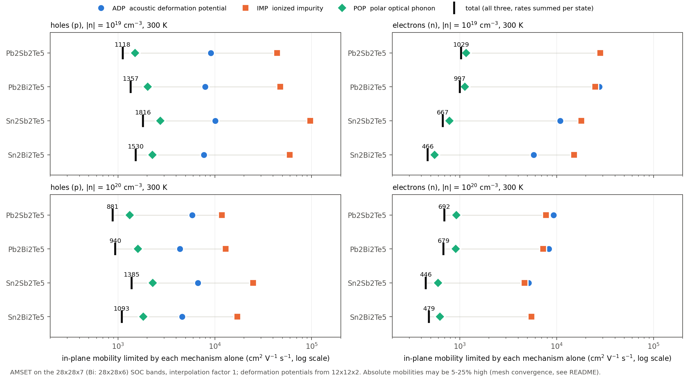
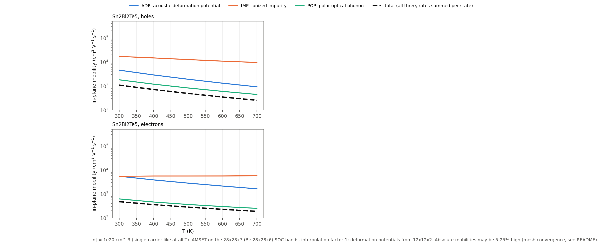

# 三种散射机制的分项迁移率（四材料对比）

2026-10-18。数据取自 `05_SOC_AMSET补算/*/04_AMSET输运/transport.json` 中的 `mobility` 分项（`overall`、`ADP`、`IMP`、`POP`），未做新计算。脚本：[`10_脚本/scattering_mobility.py`](../10_脚本/scattering_mobility.py)。

```bash
python 10_脚本/scattering_mobility.py .
```

## 算了哪些机制

| 机制 | 输入 | 来源 |
|---|---|---|
| ADP 声学形变势 | 逐带形变势 + 完整弹性张量 | `03_SOC形变势/deformation.h5`（PBE-D3+SOC 应变单点）；settings 中的 `elastic_constant` |
| POP 极性光学声子 | ε∞、ε₀ + 单一等效 LO 频率（1.9–2.15 THz） | `08_介电复核` SOC DFPT；`pop_frequency` |
| IMP 电离杂质 | ε₀ 屏蔽；`defect_charge`/`compensation_factor` 未设置，取 AMSET 默认值 | settings |

总迁移率是在每个 k 态上先把三种散射率相加后得到的，所以不能用三列分项按 1/μ 相加的方式还原。





## 300 K、面内（cm²/V·s）

| 材料 | 载流子 | 浓度 | 总 | POP | ADP | IMP |
|---|---|---|---:|---:|---:|---:|
| Pb₂Sb₂Te₅ | p | 1e19 | 292 | 400 | 2353 | 22330 |
| Pb₂Bi₂Te₅ | p | 1e19 | 278 | 427 | 1434 | 69153 |
| Sn₂Sb₂Te₅ | p | 1e19 | 654 | 946 | 4746 | 35624 |
| Sn₂Bi₂Te₅ | p | 1e19 | 574 | 832 | 6036 | 37547 |
| Pb₂Sb₂Te₅ | n | 1e19 | 351 | 401 | 5429 | 36514 |
| Pb₂Bi₂Te₅ | n | 1e19 | 316 | 345 | 6008 | 23929 |
| Sn₂Sb₂Te₅ | n | 1e19 | 212 | 267 | 1540 | 19312 |
| Sn₂Bi₂Te₅ | n | 1e19 | 152 | 173 | 2080 | 14396 |

1e20 的数据以及全部温度、zz 方向的结果见 `分项迁移率_全温度全浓度.csv`。

- **POP 在所有情况下都起主导作用**：只考虑 POP 时的迁移率与总迁移率最接近。ADP 弱 3–17 倍；IMP 几乎可以忽略，因为 ε₀ 达 300–390，屏蔽很强。
- 从 100 K 到 900 K，POP 一直是最低的那条曲线，所以主导机制不随温度改变。

## 解读前必须注意

1. **网格偏粗。** 这套 AMSET 的 SOC 能带、波函数和形变势都来自 **12×12×2 网格**（`本次输入快照/KPOINTS`），kz 方向只有 0 和 1/2 两个点，靠插值因子 10 补出中间值。而 28×28×6/7 密网格上，许多带边位于 kz = 1/7、1/6、2/7、3/7 等处。因此四材料之间的差异，尤其是 zz 方向，目前只能作定性比较。
2. **Sn 系与 Pb 系空穴迁移率差约 2 倍，现有输入解释不了。**
   - 由密网格 BoltzTraP2 的 σ/τ 得到的面内空穴电导质量 m\*_c 在四种材料中几乎相同（0.084–0.104 mₑ，1e19）。电子则是 Sn 系较重（0.11–0.24 mₑ），与 Sn 系电子迁移率较低的趋势一致。
   - POP 耦合强度 (1/ε∞ − 1/ε₀) 在 PbSb 与 SnSb 之间也几乎相同（0.0075 对 0.0074）。

   这个差别可能来自散射末态的相空间不同，也可能是粗网格造成的假象。在用密网格重跑 AMSET 之前，不应把它当作结论。

   **粗网格误差的定量检查**（`粗网格kz带边误差.csv`，不需要新计算）：只有两个 kz 平面的采样，插值后的能带极值只能落在 kz = 0 或 1/2 上。在 28×28 密网格上，把 k 点限制在这两个平面内，带边偏离真实值的程度如下（这是下限，因为实际面内只有 12×12）：

   | | Pb₂Sb₂Te₅ | Pb₂Bi₂Te₅ | Sn₂Sb₂Te₅ | Sn₂Bi₂Te₅ |
   |---|---:|---:|---:|---:|
   | VBM 偏差 / meV | 4.7 | 0.0 | 32.8 | 35.5 |
   | CBM 偏差 / meV | 7.7 | 7.9 | 18.0 | 15.3 |

   Pb 系只偏差 0–8 meV，小于 kT/3；Sn 系偏差 15–36 meV，相当于 0.6–1.4 kT。也就是说，受粗网格影响最大的正是 Sn 系，“Sn 系空穴迁移率约为 Pb 系 2 倍”很可能部分甚至全部来自这一点。
3. **建议用密网格重跑 AMSET。** `step3_uniform` 当时设了 `LWAVE=.TRUE.`，所以集群上的 WAVECAR 可以直接用 `amset wave` 生成密网格的 `wavefunction.h5`，不需要重新做能带计算。形变势最好也在更密的网格（例如 16×16×4）上重新做应变单点。
4. **没有包括的机制**：
   - 无序和缺陷本身的散射，对 D/V/O 问题影响最大；
   - 非极性光学声子和谷间散射（AMSET 不支持，需要做电声耦合计算，例如 EPW）；
   - 晶界散射。
   - 压电散射：结构有中心对称，压电张量为零，本来就不需要算。

`散射输入参数.csv` 汇总了每种材料的 ε∞/ε₀、ω_LO、Cᵢⱼ、带边形变势 E1（取自 deformation.h5 的粗网格带边）以及密网格的 m\*_c。

## 5 密网格重跑时的选带（2026-10-19）

AMSET 的 `amset wave` 和 `amset run` 都按 `energy_cutoff` 选带，规则是：只要某条带在 [VBM − e, CBM + e] 内有能量就保留（用未加剪刀的 DFT 带边）。这条规则准确复现了密网格 wave 实测的选带（e = 1.0 eV 时 PbSb 59–78、SnSb 61–80）。

用 [`10_脚本/amset_band_window.py`](../10_脚本/amset_band_window.py) 检查：在 **e = 1.5 eV（AMSET 默认值，也是旧计算所用的值）** 下，密网格选出的带与旧 `deformation.h5` 的带号**逐个重合**：PbSb 53–82、PbBi 67–100、SnSb 57–82、SnBi 73–102。而 e = 1.0 eV 时带数不同，所以 AMSET 报 “Deformation potential file does not contain the correct number of bands”。AMSET 只校验形变势的带**数**，不校验带号，所以重合的是带号这一点需要单独核对（脚本里已经做了）。

结论：把 wave 用 `-e 1.5` 重跑（每个材料约半小时），`amset run` 用默认 `energy_cutoff`，就能直接沿用旧形变势，不需要重做 28–32 h 的形变势。这样新旧计算之间唯一的实质差别是 DFT 网格（12×12×2 → 28×28×7），另外 700–900 K 下能量窗口偏紧的问题也随之消失。形变势仍来自 12×12×2，但 ADP 只是次要散射，作为局限注明即可。
