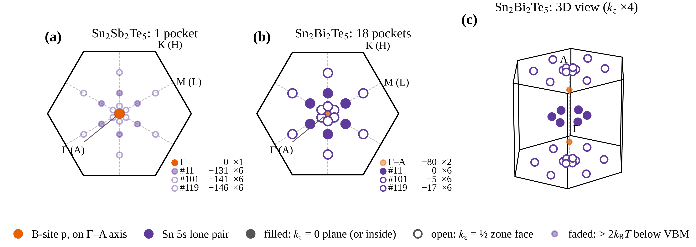
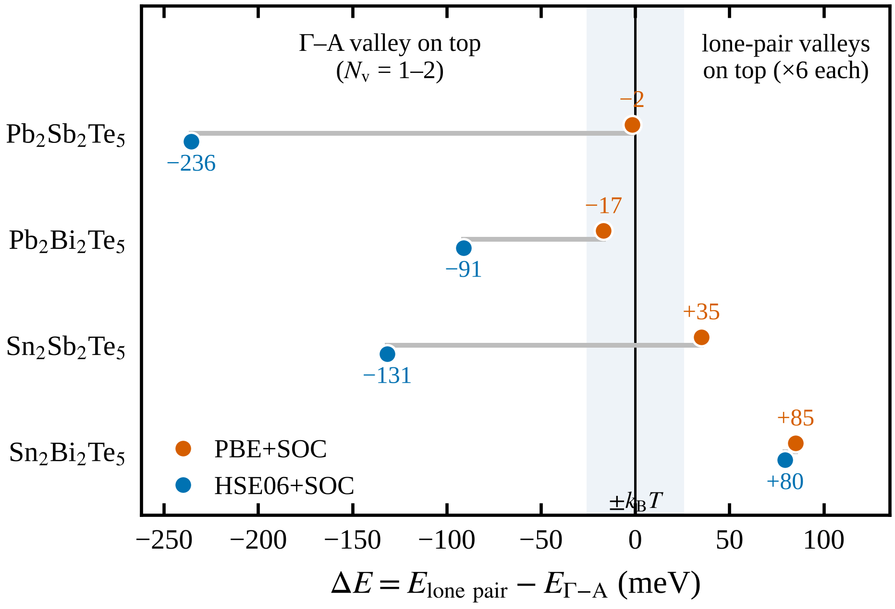

# 交接：价带口袋示意图（2026-10-29）

> **状态（2026-10-29 晚）：已完成，已并入报告。用户要求 (d) 只画 HSE，PBE 不再出现在图 6 和相关正文中，源数据改为 `crossover_energy_HSE.csv`；下文 2.4 节的 PBE 数值仅作记录。** 图 6 现为 `论文图_20261028/Fig6_valence_pockets_crossover.png/.pdf`，源数据在 `source_data/Fig6_valence_pockets/`（`pocket_positions.csv`、`crossover_energy.csv`），由 `10_脚本/paper_figures.py` 的 `fig6()` 生成；原图 6–10 已顺延为 7–11，报告 HTML 与压缩包已重新生成。
> 用户要求谷名不用路径序号，已统一改为六方布里渊区的标准记号（报告 1.2 节，`paper_figures.kname()`）：Γ–M 线 Σ、A–L 线 R（R₁ 靠近 A，R₂ 靠近 L）、Γ–A 线 Δ，另有 Λ（Γ–K）、T（M–K）、Q（A–H）、S（L–H）。本文下面的内容已按新名称替换；样稿脚本 `pocket_preview_20261029.py` 与 `交接_口袋示意图_样稿/` 已被正式版取代并删除，下文提到它们的地方以 `paper_figures.py` 为准。

这份文档写给接手绘图的智能体。任务：做新的**图 6** 插入论文报告，后面的图依次顺延。图 6 包括两部分：
- **口袋示意图**：在布里渊区中标出 Sn₂Sb₂Te₅ 与 Sn₂Bi₂Te₅ 价带顶附近的能谷（口袋）；
- **转变能量**：四种材料的孤对电子谷与 Γ–A 轴上价带态之差 ΔE，显示只有 Sn₂Bi₂Te₅ 在 HSE 下越过零点。

所需数据都已经有了，**不需要新的计算**。两部分都已有样稿（第 4 节），由 [`10_脚本/pocket_preview_20261029.py`](../10_脚本/pocket_preview_20261029.py) 生成，放在 [`交接_口袋示意图_样稿/`](交接_口袋示意图_样稿/)。

项目的整体背景、分工和历史见 [`交接文档_20261026.md`](交接文档_20261026.md)；本任务只需读下面第 0 节列出的几处。

## 0 开工前

**分支**：最新内容在 `claude/awesome-noether-ve2xee`。它包含 `claude/keen-sagan-15fv7v` 的全部提交，再加上本文档的样稿与更新；keen-sagan 上没有样稿。如果你的会话指定了别的分支，从 awesome-noether 开始：

```bash
git fetch origin claude/awesome-noether-ve2xee
git checkout -B <你的分支> origin/claude/awesome-noether-ve2xee
```

只往指定分支推送，不开 PR。

**先读**
- 报告源文件 [`论文报告_20261028.src.html`](论文报告_20261028.src.html)：
  - 1.4 节“能带的‘轻’与‘重’”一段：“18 个口袋”第一次出现的地方；
  - 第 3 节“Sn₂Bi₂Te₅ 的价带多谷从哪里来”：图 5、表 5 和下面的要点；
  - 第 4 节关于 c3 的说明：离轴谷的真实极大偏离路径。
- [`22_能带基准_1-0/Sn2Bi2Te5/c3_valley/README.md`](../22_能带基准_1-0/Sn2Bi2Te5/c3_valley/README.md) 的“结果”和“结论”。

**规则**
- 用中文回答用户。全部为理论计算。
- 不做新的 DFT 计算，不安装 BoltzTraP2 之类的程序。不改 AutoZT 的代码；项目自己的脚本可以改。
- 提交信息用中文，不写模型名。

**用户的绘图偏好**（之前提过的）
- 英文用 Times New Roman。`paper_figures.py` 的 `style()` 已设好；没有 TNR 时用度量相同的 Liberation Serif。
- 面板标题放在图的正上方。
- 图例、标注不能互相遮挡。
- 同类数据用统一的标记。
- 报告文字简洁：该交代的交代清楚，其余从简。

**已完成，不要重做**：Γ 处反转带隙的出处与解读已写入报告（提交 `e39cb5c`）。改动包括：
- 表 5 新增“Γ 最低导带态”一行；
- 第 3 节的“Γ 处的反转带隙”“原因（推测）”两条要点；
- 拓扑段列出三种材料的反转带隙；
- `band_gaps_on_path.csv` 和 `Gamma_states.csv` 两个源数据文件。

**已有样稿，在其基础上改，不要从零开始**：`10_脚本/pocket_preview_20261029.py`（样稿图、`pocket_positions.csv`、`valley_offsets.csv`），见第 4 节。

## 1 图要表达什么

**口袋（报告中的用法）**：能谷是能带的一个极值。晶体对称性（P-3m1，点群 D3d，12 个操作，含 C3 与反演）会把不在高对称点上的极值复制成几个能量相同的等价副本。每个副本在 k 空间是一小块容纳载流子的区域，叫一个口袋。Γ 是单点，只有 1 个口袋；Γ–M 或 A–L 线上的谷各有 6 个。

**要让读者一眼看到的对比**
- **(a) Sn₂Sb₂Te₅**：价带顶是 Γ 处一个口袋（以 Sb-p 为主）。三组 Sn 5s 孤对电子谷比它低 131–146 meV，基本不参与导电。
- **(b) Sn₂Bi₂Te₅**：Γ 单谷降到 −95 meV。价带顶由三组孤对电子谷组成，每组 6 个，17 meV 内共 18 个口袋。

这张图配合图 5：图 5 只沿一条路径，每组谷在路径上只出现一次，看不出每组有 6 个副本；新图要补的就是这一点。

### 1.1 文献中的常见画法

热电文献展示口袋和谷间能量差，常见的有四种：

| 画法 | 代表文献 | 怎么画 | 本项目能否用 |
|---|---|---|---|
| **等能面** | Zhang 等, *Nat. Commun.* 8, 13901 (2017)：Mg₃Sb₂（与本体系同为 P-3m1）。图 2d 为导带底以上 0.03 eV 的等能面：M–L 线上 6 个完整电子口袋，K 点 6 个 1/3 口袋；图 2e 为 p 型，只有 Γ 一个空穴口袋 | 在三维布里渊区中画距带边固定能量（如 30 meV）的等能面，两种情况并排比较。常用 IFermi（Ganose 等, *JOSS* 6, 3089, 2021）、FermiSurfer、pyprocar 生成 | **不能**：需要全区三维能量网格，我们只有路径。原样照搬需要新计算 |
| **布里渊区示意 + 标出谷的位置** | Bi₂Te₃ 的“六谷模型”：6 个价带谷两两位于含三重轴的镜面内，偏离 Γ–Z 线（Mishra 等, *J. Phys.: Condens. Matter* 9, 461, 1997；ARPES 见 arXiv:0803.0052）。PbTe 的 L/Σ 双价带示意（Pei 等, *Nature* 473, 66, 2011） | 画布里渊区线框，用符号或小椭球标出各谷位置，同类谷同色，常配俯视或三维透视 | **能**，这就是本图的做法。只画位置和个数，不画大小 |
| **谷间能量差 ΔE** | PbTe 的 ΔE(L–Σ) 随成分、温度变化（Pei 2011）；Mg₃Sb₂₋ₓBiₓ 中 Γ 单谷随 Bi 含量下移、逼近六重导带谷（arXiv:1907.02263，表 I 列出各谷能量差） | 横轴为成分或材料，纵轴为两组谷的能量差，零线表示“收敛/交叉”，常加 ±k_BT 阴影 | **能**，即本图的转变能量部分 |
| **谷简并度表** | Mg₃Sb₂ 的 ML 谷 N_v = 6、K 谷 N_v = 2（Zhang 2017）；Fermi 面复杂度因子 N_v\*K\*（Gibbs 等, *npj Comput. Mater.* 3, 8, 2017） | 表中列每个谷的位置、能量、N_v | **能**，即表 5 与 2.4 节的表 |

**本项目的选择**：
- 口袋：用第二种画法。沿 c 俯视的两个面板对比两种材料，另加 Sn₂Bi₂Te₅ 的三维透视。
- 转变能量：用第三种画法，每种材料 PBE、HSE 各一个点。
- 图注写明是示意图、没有等能面，理由见第 3 节。

参考文献在报告中只在图注或正文里简要提及，例如“画法参照 Mg₃Sb₂ 的口袋图”。文献信息核对过题名、期刊和年份，但未逐图核对原文。若要在报告中引用具体图号，先核对原文。

## 2 数据

### 2.1 谷的位置与能量（HSE06+SOC，相对各自价带顶）

来源：`21_阶段报告与交接/论文图_20261028/source_data/Fig5_SnSb_vs_SnBi/` 下的 `Sn2Sb2Te5_valence_valleys.csv`、`Sn2Bi2Te5_valence_valleys.csv`，与表 5 相同。

| 谷 | 路径序号 | 路径上的分数坐标 | 所在面 | 等价口袋数 | Sn₂Sb₂Te₅ (meV) | Sn₂Bi₂Te₅ (meV) | 特征 |
|---|---|---|---|---|---|---|---|
| Γ | 0 | (0, 0, 0) | k_z = 0 | 1 | **0**（价带顶） | −95.0 | B 位 p（Sb-p 43%、Bi-p 42%） |
| Σ | 11 | (−1/6, 0, 0)，Γ–M 的 1/3 处 | k_z = 0 | 6 | −131.5 | **0**（价带顶） | Sn 5s 孤对电子（Sn-s 18–20%） |
| R₁ | 101 | (−2/33, 0, −1/2)，A–L 的 4/33 处 | k_z = ½ 顶面 | 6 | −141.0 | −5.2 | Sn 5s 孤对电子（Sn-s 22–23%） |
| R₂ | 119 | (−1/3, 0, −1/2)，A–L 的 2/3 处 | k_z = ½ 顶面 | 6 | −145.9 | −17.2 | Sn 5s 孤对电子（Sn-s 22–23%） |

路径的高对称点（`22_能带基准_1-0/c2_path/KPOINTS_OPT`）：
- Γ (0,0,0)、M (−1/2,0,0)、K (−2/3,1/3,0)；
- A (0,0,−1/2)、L (−1/2,0,−1/2)、H (−2/3,1/3,−1/2)。

k_z = −½ 与 +½ 相差一个倒格矢，是同一个面。

**新发现：Sn₂Bi₂Te₅ 中 Γ 不是 B 位 p 谷的真正极大。** 沿 Γ–A，最高价带从 Γ 的 −95.0 meV 升到 Γ–A 线 4/7 处（路径序号 94，分数坐标 (0, 0, −2/7)）的 −79.5 meV，再降到 A 的 −88.6 meV。
- 这一点的成分是 Te-p 50%、Bi-p 22%、Bi-s 7%、Sn-s 3%（`Sn2Bi2Te5_HSE06+SOC_projections.csv`）。也就是说，从 Γ 到 A，成分由 Bi-p 为主逐渐变成 Te-p 为主。
- 它在 ±k_z 各一个，共 **2 个口袋**。
- 仍在价带顶 2k_BT（52 meV）以外，**结论不变**：价带顶附近仍只有 18 个孤对电子口袋。
- Sn₂Sb₂Te₅（HSE）的 Γ 是真正的极大：沿 Γ–A 单调下降。

图上 Sn₂Bi₂Te₅ 的中心标记用这个 −80 meV 的 Γ–A 极大（×2），不用 Γ 的 −95。报告中改动见 5.2 节。

### 2.2 晶格与布里渊区

POSCAR 用 `A2B2Te5_SOC_dense/materials/<材料>/POSCAR`（用户的 9 原子层状结构，能带就是用它算的）。a₁ = (a, 0, 0)，a₂ = (−a/2, √3a/2, 0)，a₁ 与 a₂ 夹 120°。

| | a (Å) | c (Å) | \|b₁\| (Å⁻¹，含 2π) | \|b₃\| (Å⁻¹) |
|---|---|---|---|---|
| Sn₂Sb₂Te₅ | 4.3545 | 17.2200 | 1.6662 | 0.3649 |
| Sn₂Bi₂Te₅ | 4.4143 | 17.3530 | 1.6436 | 0.3621 |

- 布里渊区是很扁的六棱柱：面内宽约 1.9 Å⁻¹，高只有约 0.36 Å⁻¹。
- 以 Sn₂Bi₂Te₅ 为例：六边形顶点在 K（离中心 0.949 Å⁻¹），边中点在 M（0.822 Å⁻¹），顶面在 k_z = 0.181 Å⁻¹。
- 两种材料只差约 1.4%，画示意图时各用自己的晶格即可。

### 2.3 18 个口袋的坐标（已用 spglib 核对）

这些坐标由 spglib 2.8 从 Sn₂Bi₂Te₅ 的 POSCAR 取出的 12 个点群操作作用在路径坐标上得到，去重时模去倒格矢。结果是 Γ 1 个、Σ 6 个、R₁ 6 个、R₂ 6 个。笛卡尔坐标用 Sn₂Bi₂Te₅ 的晶格，单位 Å⁻¹。

| 谷 | 分数坐标（6 个，按 ± 成对） | 面内离中心距离 (Å⁻¹) | k_z |
|---|---|---|---|
| Σ | ±(1/6, 0, 0)，±(0, 1/6, 0)，±(1/6, −1/6, 0) | 0.274 | 0 |
| R₁ | (±2/33, 0, ½)，(0, ±2/33, ½)，±(2/33, −2/33, 0) + (0, 0, ½) | 0.0996 | ½ |
| R₂ | (±1/3, 0, ½)，(0, ±1/3, ½)，±(1/3, −1/3, 0) + (0, 0, ½) | 0.548 | ½ |

沿 c 俯视时，Γ–M 与 A–L 投影到同一组方向：6 条从中心指向 M 的射线。所以 18 个口袋落在这 6 条射线上，按离中心的距离分三档：
- 0.10 Å⁻¹：R₁，在顶面；
- 0.27 Å⁻¹：Σ，在 k_z = 0 面；
- 0.55 Å⁻¹：R₂，在顶面。

脚本里请用下面的方法重新生成，不要手抄上表，并检查个数是 1、6、6、6：

```python
import numpy as np, spglib
lat, frac, species = read_poscar(path)           # paper_figures.py 已有 read_poscar()
num = [sorted(set(species)).index(e) for e in species]
rots = spglib.get_symmetry((lat, frac, num), symprec=1e-3)['rotations']
rots = np.unique(rots.reshape(len(rots), -1), axis=0).reshape(-1, 3, 3)   # 12 个点群操作
B = 2 * np.pi * np.linalg.inv(lat).T                                       # 行为 b1, b2, b3（Å⁻¹）
def star(k):
    out = []
    for R in rots:
        for s in (1, -1):                                                  # 含时间反演（有反演时不增加新点）
            q = s * (np.asarray(k) @ R); q -= np.round(q); q[np.isclose(q, -0.5)] = 0.5
            if not any(np.allclose(q, p, atol=1e-6) for p in out): out.append(q)
    return out                                                             # 笛卡尔坐标：q @ B
```

### 2.4 转变能量

**定义**：ΔE = E(最高孤对电子谷) − E(Γ–A 轴上最高的价带态)，两者取自同一个计算，与能量零点无关。
- 孤对电子谷用图 6（改号后为图 7）的同一判据：阳离子 s ≥ 15%，且沿 c 不是鞍点（`report_figures_20261028.lone_pair_offset`）。
- 为什么用 Γ–A 轴而不只用 Γ：Pb₂Bi₂Te₅ 的价带顶在 A，Pb₂Sb₂Te₅（PBE）和 Sn₂Bi₂Te₅ 的轴上极大在 Γ–A 线中间（2.1 节）。只取 Γ 会把这些情况算错。
- **ΔE > 0**：孤对电子多谷在上，每组 6 个口袋。**ΔE < 0**：轴上的 1–2 个口袋在上。

来源：`交接_口袋示意图_样稿/valley_offsets.csv`（由 `pocket_preview_20261029.py` 从 `path_eigen.txt`、`PROCAR_OPT.gz` 重算）。单位 meV，相对各自价带顶；括号内是路径序号和等价口袋数。

| 材料 | 泛函 | E(Γ) | Γ–A 轴上最高 | 最高孤对电子谷 | **ΔE** | 只用 Γ 时的 ΔE |
|---|---|---|---|---|---|---|
| Pb₂Sb₂Te₅ | PBE+SOC | −7.5 | **0**（Δ，×2） | −1.7（Σ，×6） | **−1.7** | +5.8 |
| | HSE06+SOC | **0** | **0**（Γ，×1） | −235.6（Σ，×6） | **−235.6** | −235.6 |
| Pb₂Bi₂Te₅ | PBE+SOC | −199.2 | **0**（A，×1） | −16.8（Σ，×6） | **−16.8** | +182.4 |
| | HSE06+SOC | −51.6 | **0**（A，×1） | −91.0（Σ，×6） | **−91.0** | −39.4 |
| Sn₂Sb₂Te₅ | PBE+SOC | −37.2 | −35.1（Δ，×2） | **0**（Σ，×6） | **+35.1** | +37.2 |
| | HSE06+SOC | **0** | **0**（Γ，×1） | −131.5（Σ，×6） | **−131.5** | −131.5 |
| Sn₂Bi₂Te₅ | PBE+SOC | −231.7 | −85.1（A，×1） | **0**（Σ，×6） | **+85.1** | +231.7 |
| | HSE06+SOC | −95.0 | −79.5（Δ，×2） | **0**（Σ，×6） | **+79.5** | +95.0 |

要点（可写进图注或正文）：
- **HSE 下只有 Sn₂Bi₂Te₅ 越过零点**（+80 meV），其余三种都是轴上单谷在上（−91 到 −236 meV）。Sn₂Sb₂Te₅ → Sn₂Bi₂Te₅ 的转变量为 +79.5 − (−131.5) = **211 meV**；只用 Γ 时为 226.5 meV，即报告第 3 节的“约 225 meV”。
- **泛函的影响**：PBE → HSE 时，Pb₂Sb₂Te₅、Pb₂Bi₂Te₅、Sn₂Sb₂Te₅ 的 ΔE 分别下降 234、74、167 meV，Sn₂Bi₂Te₅ 只降 6 meV。
  - Sn₂Sb₂Te₅ 在 PBE 下 ΔE > 0，在 HSE 下 < 0：泛函决定了它在零点的哪一边。这与报告第 2 节“PBE 高估孤对电子谷”一致。
  - Sn₂Bi₂Te₅ 两种泛函下都是 +80 到 +85 meV，“多谷在上”的结论两种泛函一致。
  - Pb₂Sb₂Te₅（PBE）的 −1.7 meV 几乎正好收敛，但 HSE 下离零点最远（−236 meV）。
- **路径值是 ΔE 的下限**：
  - 轴上的态（Γ、A、Γ–A 线）在三重轴上，面内梯度由对称性为零，路径上的极大就是真实极大。
  - 孤对电子谷是离轴谷，真实极大比路径值高。c3 对 Sn₂Bi₂Te₅ 的二次外推是高 5–60 meV，只作量级参考（第 3 节第 1 点）。
  - 所以 Sn₂Bi₂Te₅ 的 ΔE > 0 不受影响。ΔE < 0 的材料真实值会更接近零：HSE 下 −91 到 −236 meV，比 c3 的外推量级大，符号大概率不变，但没有算过；PBE 下 Pb₂Sb₂Te₅ 的 −1.7 meV 可能变号。图注里写“路径值，孤对电子谷为下限”。

## 3 必须在图注或正文里交代的两点

1. **位置是示意，个数可靠。** 图上的位置是能带路径上的极值点。c3 已表明三组谷在路径上都不是三维极值：
   - Σ 是鞍点；
   - R₁、R₂ 的驻点偏离约 0.05 Å⁻¹，主要沿 c。

   原因是 Γ–M、A–L 线位于含 c 轴的镜面内，对称性不要求沿 c 的梯度为零，所以真实极大在镜面内的一般 k_z 处。
   - **个数**：镜面内一般点的小群只有 {E, 镜面} 两个操作（已用 spglib 核对），等价点仍是 12/2 = 6 个，18 不变。条件是真实极大仍在镜面内；c3 中垂直镜面方向的曲率为负，支持这一点。
   - **形状**：6 个副本会交替地略高于、略低于原来的面（C3 给出同侧 3 个，反演给出另一侧 3 个）。
   - **不要画**沿 k_z 偏移的具体数值，c3 的外推超出了采样半径。
   - 真实位置要等 c4_mirror。它目前因 FOCK_FCC 崩溃，需要重新设计，见 `22_能带基准_1-0/Sn2Bi2Te5/c4_mirror/崩溃分析_FOCK_FCC_NKRED.md`。

2. **只画谷的中心，不画口袋的形状和大小。**
   - 没有三维能量网格；c3 的质量是在非驻点处拟合的，不能用来画椭球。
   - 3×10¹⁹ cm⁻³ 时 Sn₂Bi₂Te₅ 的费米能级在价带顶以上 6 meV，落在带隙里。空穴是热激发进这些谷的，严格说没有费米面。

   所以图上画的是“谷的位置”，不是费米面，图注里要这样写。

## 4 推荐画法与样稿

样稿由 `python3 10_脚本/pocket_preview_20261029.py` 生成（需 matplotlib、spglib）。正式版并入 `paper_figures.py` 时可以调整，但要满足第 1、3 节。

### 4.1 口袋：样稿 A



- **(a) Sn₂Sb₂Te₅、(b) Sn₂Bi₂Te₅**：沿 c 俯视六边形布里渊区。
  - 俯视时 A 与 Γ、L 与 M、H 与 K 重合，标签写成 “Γ (A)”“M (L)”“K (H)”。
  - 6 条灰色虚线是 Γ–M 方向，18 个孤对电子口袋都在这些线上，按离中心的距离分三档。
  - 面板标题写口袋数：价带顶 2k_BT 以内的口袋（1 个 / 18 个）。
- **(c) Sn₂Bi₂Te₅ 三维透视**：扁六棱柱，k_z 放大 4 倍（标题注明）。
  - 区界面上的口袋顶面、底面各画一次，是同一个口袋；图注要说明。
  - 只画 Sn₂Bi₂Te₅，因为 Sn₂Sb₂Te₅ 价带顶只有 Γ 一个点，画三维没有信息量。
- **标记**：
  - 颜色区分轨道特征，与图 5(e) 一致：橙色 `C_B = '#E66100'` 为 Γ–A 轴上的 B 位 p 态，紫色 `C_A = '#5D3A9B'` 为 Sn 5s 孤对电子谷。
  - 形状区分所在面：实心为 k_z = 0 面或区内，空心为 k_z = ½ 区界面。
  - 离价带顶超过 2k_BT（52 meV）的谷画小、画淡（Sn₂Sb₂Te₅ 的三组孤对电子谷、Sn₂Bi₂Te₅ 的 Γ–A 态）。
  - 每个面板右下角列小表：谷、能量（meV）、等价口袋数。
- **口袋坐标**：用 `ws()` 换到第一布里渊区，即取面内最短的等价像。spglib 给出的等价点只是模倒格矢去重，不在第一区。例如 M 的三个代表里 (½, ½, 0) 在区外，直接画会落在六边形外。

样稿已知的小问题，正式版要修：
- 图例离面板太远；
- (c) 的标题偏高；
- (c) 中心附近的 R₁ 口袋挤在一起，可以把三维面板放大，或把 k_z 放大到 5–6 倍。

### 4.2 转变能量：样稿 B



- 单栏宽 3.35 in。四种材料各一行，橙色为 PBE+SOC，蓝色为 HSE06+SOC，灰线连接同一材料。样式与现在的图 6（改号后为图 7）相同。
- 竖直黑线是 ΔE = 0（交叉点），阴影是 ±k_BT（300 K，26 meV）。左右两侧标出“轴上谷在上”和“孤对电子谷在上”。
- **和现在的图 6 的区别**：图 6 画的是孤对电子谷相对价带顶的位置，总是 ≤ 0，看不出“谁在上”。ΔE 可正可负，正好显示 Sn₂Bi₂Te₅ 越过零点。两张图互补，都保留。

### 4.3 组合方式

推荐把 A、B 合成一张图 6：上排 (a)(b)(c) 为口袋，下排 (d) 为转变能量，(d) 可以放窄一点、居中，或在旁边放一个 Sn₂Sb₂Te₅ → Sn₂Bi₂Te₅ 的能级示意。这样只新增一个图号，不新增表号。

如果用户更想要表，2.4 节的表可以作为新表插入报告。但这会让表 6–10 顺延，改动面更大，先问用户。

### 4.4 图注草稿

按实际画法改：

> **图 6** 价带顶附近的能谷（口袋）与“Γ 单谷 → 孤对电子多谷”的转变（HSE06+SOC，(d) 另含 PBE+SOC）。(a) Sn₂Sb₂Te₅、(b) Sn₂Bi₂Te₅ 沿 c 俯视的布里渊区，(c) Sn₂Bi₂Te₅ 的三维透视（k_z 放大 4 倍）。橙色为 Γ–A 轴上以 B 位 p 为主的态，紫色为 Sn 5s 孤对电子谷；实心标记在 k_z = 0 面或区内，空心标记在 k_z = ½ 区界面（顶面与底面是同一个口袋）；淡色标记离价带顶超过 2k_BT。角上的小表列出各组相对价带顶的能量（meV）与等价口袋数。Sn₂Sb₂Te₅ 价带顶只有 Γ 一个口袋，孤对电子谷低 131–146 meV；Sn₂Bi₂Te₅ 的价带顶由三组、每组 6 个孤对电子口袋组成，17 meV 内共 18 个，B 位 p 态降到 −80 meV。(d) ΔE = E(最高孤对电子谷) − E(Γ–A 轴上最高价带态)，阴影为 ±k_BT（300 K）。只有 Sn₂Bi₂Te₅ 在 HSE 下 ΔE > 0。图中只标谷的中心，位置取能带路径上的极值点，没有画等能面；真实极大在含 c 轴的镜面内略偏离这些点（第 4 节），只要仍在镜面内，个数不变。

## 5 要改的文件

### 5.1 `10_脚本/paper_figures.py`

- 新增画图函数，`save(fig, out, 'Fig6_valence_pockets_BZ')`。把 `pocket_preview_20261029.py` 的 `lattice()`、`star()`、`ws()`、`offsets()`、`pockets()`、`top_view()`、`persp()`、`figB()` 搬进来，改用 `dump()` 写源数据：
  - `dump('Fig6_valence_pockets', 'pocket_positions.csv', ...)`：每行一个口袋，列与样稿相同。共 39 行：Sn₂Sb₂Te₅ 1 + 18，Sn₂Bi₂Te₅ 2 + 18。
  - `dump('Fig6_valence_pockets', 'valley_offsets.csv', ...)`：2.4 节的表，8 行。
- `paper_figures.py` 现在没有 `import spglib`，要加上。本机没有时 `pip install spglib`。
- 搬完后删除 `10_脚本/pocket_preview_20261029.py` 和 `交接_口袋示意图_样稿/`（用 `git rm`），或保留并在文件开头注明“已并入图 6”。二选一，问用户。
- 原图 6–10 顺延为 7–11。函数名、`save()` 文件名、`dump()` 目录名、`main()` 的映射和 `range(1, 11)`、文件开头的图号列表都要改：

| 原 | 新 |
|---|---|
| `Fig6_lone_pair_valley_PBE_vs_HSE` / 目录 `Fig6_lone_pair_valley` | `Fig7_…` / `Fig7_lone_pair_valley` |
| `Fig7_Seebeck_PBE_vs_HSE` / `Fig7_Seebeck`（`valley_shares()` 也写这个目录） | `Fig8_…` / `Fig8_Seebeck` |
| `Fig8_S_vs_T_experiment` / `Fig8_S_vs_T` | `Fig9_…` / `Fig9_S_vs_T` |
| `Fig9_defect_formation_energies` / `Fig9_formation_energies` | `Fig10_…` / `Fig10_formation_energies` |
| `Fig10_ordering_induced_change` / `Fig10_ordering` | `Fig11_…` / `Fig11_ordering` |

**从大号往小号改**（先 10→11，最后 6→7），避免重名覆盖。

### 5.2 `21_阶段报告与交接/论文报告_20261028.src.html`

- **插入新图**：在第 3 节表 5 后面的要点列表之后、“拓扑”段之前插入。格式照抄图 5 的 `<figure>` 块：`` 加 `<figcaption>`。
- **补口袋的定义**：1.4 节“Sn₂Bi₂Te₅ 的价带顶由 18 个口袋组成”后加一句定义，例如：“（一个能谷连同晶体对称性给出的等价副本，每个副本在 k 空间是一小块容纳空穴的区域，称为一个口袋；位置见图 6）”。
- **加引用**：第 4 节“17 meV 内三组、共 18 个口袋”后加“（图 6）”。
- **Γ–A 极大（2.1 节）**：表 5 和第 3 节保持 Γ 点的数（−95 meV，反转带隙 277 meV 都是 Γ 点的量，不用改）。在第 3 节“Bi 的作用是压低 Γ 单谷”一条末尾加一句，例如：“Sn₂Bi₂Te₅ 中这条带沿 Γ–A 略有上升，最高处在 Γ–A 的 4/7 处，为 −80 meV（Te-p 50%、Bi-p 22%），仍在价带顶 2k_BT 以外，见图 6。”
- **转变能量**：第 3 节要点列表中加一条，引用图 6(d)，写 2.4 节第一、二个要点（只有 Sn₂Bi₂Te₅ 越过零点，转变量 211 meV；PBE 普遍高估）。“约 225 meV”保留，它是 Γ 点的值，要注明 211 meV 是按 Γ–A 极大算的。
- **正文图号**：“图 6”到“图 10”全部加 1，所有 `{{FIG:…}}`、`alt="Fig. N"`、`<b>图 N</b>` 一并改，同样从大号往小号改。改完逐处读上下文，确认每个“图 N”指的仍是原来那幅图。
- **附录“数据与文件”表**：增加图 6 一行，原图 6–10 的行改号、改文件名和目录名。
- 表号不变（仍为表 1–10）。

### 5.3 其他文件

- `10_脚本/build_paper_report.py`：开头说明与 `readme()` 中的“图 1–10”“Fig10_ordering”及各目录名，按新编号改；增加 `Fig6_valence_pockets/` 一行说明。
- `22_能带基准_1-0/多谷S估计_HSE.md` 第 33 行、`21_阶段报告与交接/结论报告_20261028.md` 第 101 行引用了 `Fig7_Seebeck/` 路径，改成 `Fig8_Seebeck/`。
- **删除旧文件**：`论文图_20261028/` 下旧编号的 PNG、PDF，以及 `source_data/` 下旧编号的目录，用 `git rm`。`build_paper_report.py` 会把 `Fig*.png`、`Fig*.pdf` 和整个 `source_data/` 都打进压缩包，留下旧文件就会混进去。

### 5.4 重新生成

```bash
python3 10_脚本/paper_figures.py          # 全部 11 幅图与源数据
python3 10_脚本/build_paper_report.py     # 单文件 HTML 与压缩包
```

## 6 验收

1. 脚本中 `star()` 的个数：Sn₂Sb₂Te₅ 为 Γ 1、Σ 6、R₁ 6、R₂ 6；Sn₂Bi₂Te₅ 为 Γ–A 2、Σ 6、R₁ 6、R₂ 6。`pocket_positions.csv` 共 39 行，不含表头。`valley_offsets.csv` 8 行，数值与 2.4 节的表一致。
2. 用 Read 工具打开新图的 PNG，亲眼检查：
   - 标题在正上方，没有重叠；
   - 字体是 Times New Roman，或 Liberation Serif；
   - 实心与空心标记和图例对得上；
   - 18 个点落在 6 条射线、三档距离上，全部在六边形内；
   - (d) 的数字标签与 2.4 节的表一致，右侧文字没有被边框截断。
3. `ls 21_阶段报告与交接/论文图_20261028/Fig*` 恰好 11 个 PNG、11 个 PDF；`source_data/` 下恰好 11 个 `FigN_…` 目录，没有旧编号的残留。
4. `grep -o '{{FIG:[^}]*}}' 21_阶段报告与交接/论文报告_20261028.src.html` 按顺序是 Fig1 到 Fig11，各出现一次。`grep -o '图 [0-9]*'` 的引用与图的内容逐一对上。
5. `unzip -l 21_阶段报告与交接/A2B2Te5_report_20261028.zip` 中有 `figures/png/Fig6_valence_pockets_BZ.png` 和 `data/Fig6_valence_pockets/`，没有旧文件名。
6. 其他图的内容不要改，只改编号。特别是现在的图 8（改号后为图 9）S(T) 中的 “Experiment” 图例，用户没有要求去掉。

## 7 提交与推送

确认 `git status` 里没有多余文件后再提交。提交信息示例：

```
论文报告：新增图 6（价带口袋在布里渊区中的位置与孤对电子谷的转变能量），原图 6–10 顺延为 7–11
```

推送：`git push -u origin <你的分支>`。只在网络错误时重试，最多 4 次，间隔 2、4、8、16 秒。推送后用 `git log origin/<你的分支> -1` 确认。
