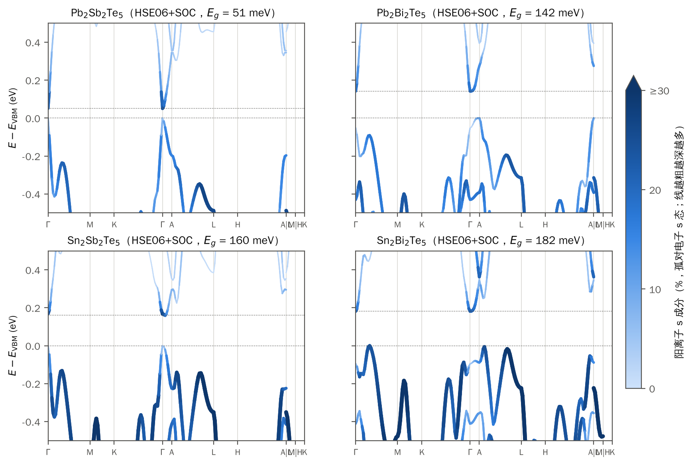
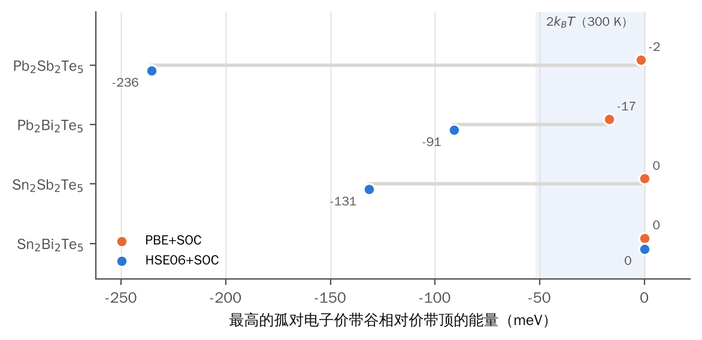
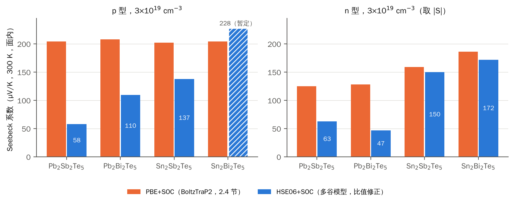
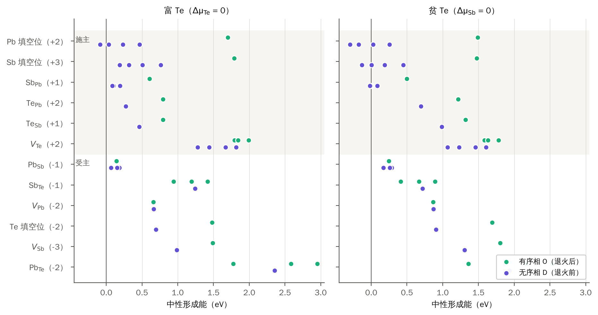
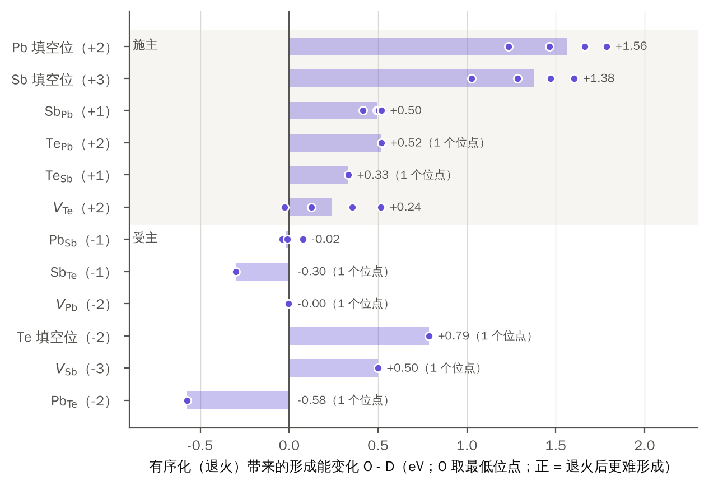

# A₂B₂Te₅ 中的孤对电子与导电类型：结论报告

2026-10-28。研究对象：Pb₂Sb₂Te₅、Pb₂Bi₂Te₅、Sn₂Sb₂Te₅、Sn₂Bi₂Te₅（A = Pb/Sn，B = Sb/Bi）。只用理论计算。

本报告把两个问题的当前结论集中写清楚，取代 [`阶段报告_20261023.md`](阶段报告_20261023.md) 作为现行版本（旧报告保留，含更多中间过程）。图由 `10_脚本/report_figures_20261028.py` 从仓库数据生成。**唯一的暂定值是 Sn₂Bi₂Te₅ 的 p 型 Seebeck 系数**：它依赖的价带谷质量张量（c3_valley）正在计算，出来后替换。

| 问题 | 内容 |
|---|---|
| 问题一 | 孤对电子（带边 s 成分、反键态）如何影响 Seebeck 系数 S 和电输运，p 型与 n 型分开 |
| 问题二 | 退火前（阳离子与空位无序）和退火后（有序）的主导缺陷，以及 p/n 转变（对照 Evang 等，Adv. Mater. 34, 2106868 (2022)） |

## 摘要

**问题一**
1. 孤对电子是**已被填满的阳离子 s – Te p 反键态**，化学键主要靠 p–p 成键。
2. 在 HSE06+SOC 能带中，这个反键态有两处落脚（图 1）：**离开 Γ 的价带谷**，和 **Γ 处的导带底**（s 态在 Γ 处被反转到阳离子 p 态之上，三种材料已用宇称确认是强拓扑绝缘体 Z2 = (1;000)）。Γ 处的价带顶是阳离子 p 态，不是孤对电子。
3. 与 PBE 相比，HSE 把孤对电子价带谷压低：PbSb、PbBi、SnSb 分别到价带顶下 236、91、131 meV；**只有 SnBi 的价带顶仍是孤对电子谷**（图 2）。
4. **p 型**：同浓度 S 的排序变为 SnBi > SnSb > PbBi > PbSb，与孤对电子谷占电导的份额（约 97%、44%、13%、17%）一致——孤对电子谷越靠近价带顶，S 越高。PBE 下“四种材料 p 型 S 相同”不再成立（图 3）。
5. **n 型**：四种材料的导带底都是孤对电子 s 态（Γ 单谷，阳离子 s 20–28%），所以 n 型载流子在带边处就是孤对电子态；但同浓度 |S| 由 Sn 系的一个阳离子 p 导带口袋（约 65 meV 处）决定：Sn 系 |S| 是 Pb 系的 2.4–3.7 倍（图 3）。

**问题二**
1. 在同一母格、同一组成（144 原子超胞）上计算了 12 类点缺陷、45 个位点。
2. **退火后（有序相）的主导缺陷是受主 Pb_Sb**，在整个化学势范围内都最低，净受主，**p 型**（图 4）。
3. **退火前（无序相）的主导缺陷是施主**：Pb 填阳离子空位最低，其次 Sb_Pb、Sb 填空位；无序相中所有受主（阳离子空位、阳离子替 Te、Te 填空位）都在 0.66 eV 以上，补偿不了施主，净施主，**n 型**（富 Te 端较弱）（图 4）。
4. **转变机理：有序化让施主全面变贵（0.3–1.8 eV），而受主 Pb_Sb 几乎不变**（图 5）。这与 Evang 等的结论逐项一致。

---

## 1 方法（简）

| 项 | 问题一 | 问题二 |
|---|---|---|
| 结构 | 9 原子原胞（P-3m1），PBE-D3 弛豫 | 144 原子超胞 Pb₃₂Sb₃₂Te₈₀ + 16 个阳离子结构空位（阳离子位的 20%）；无序相 D：阳离子与空位随机分布；有序相 O：空位成层、阳离子分层。同一母格、同一组成 |
| 电子结构 | PBE+SOC 与 HSE06+SOC；204 点能带路径（c2），在与自洽网格重合的 18 点上逐带核对到 0.07 meV；PROCAR 给成分；TRIM 点宇称给拓扑 | PBE-D3，Γ 2×2×2；缺陷 ISIF=2 弛豫，能量取 `LREAL=.FALSE.` 的单点 |
| 输运 / 判型 | 多谷模型：能谷直接取自 HSE 路径（Kane 型非抛物拟合），常数弛豫时间，300 K，面内；同一模型跑 PBE 路径，按与 BoltzTraP2 的比值校准 | 中性形成能；化学势取 PbTe + Sb₂Te₃ 共存线两端（富 Te：Δμ_Te = 0；贫 Te：Δμ_Sb = 0）；电子计数定电荷，浅能级近似求净载流子 |

---

## 2 问题一：孤对电子如何影响 S 和输运

### 2.1 孤对电子在能带中的位置

**图 1** HSE06+SOC 能带，颜色和线宽表示阳离子 s 成分（孤对电子 s 态的含量）。零点为价带顶，两条虚线分别是价带顶和导带底。

怎么读：
- **深色粗线 = 孤对电子态**（阳离子 s 与 Te p 的反键态，阳离子 s 占 20–30%）。它们出现在两处：
  - **离开 Γ 的价带谷**，例如 Γ–M 线上 (1/6,0,0) 附近、A–L 线上的峰；
  - **Γ 处的导带底**。
- **浅色细线 = 阳离子 p 态**。Γ 处的价带顶（PbSb、SnSb）就是这一类，阳离子 s 只有 0–2%。
- 这种“s 在导带、p 在价带”的 Γ 处带序是反转的：正常带序应是 s–p 反键在价带。TRIM 点宇称表明 SnSb、PbBi、SnBi 在 PBE 和 HSE 下都是强拓扑绝缘体，Z2 = (1;000)，反转都在 Γ（irrep 与自写脚本两法一致；PbSb 待补）。**孤对电子的 s 态被反转到 p 态之上，正是非平庸拓扑的来源。**

### 2.2 HSE 把孤对电子价带谷压到价带顶之下（SnBi 除外）

**图 2** 最高的孤对电子价带谷（阳离子 s ≥ 15% 的真实极大，鞍点除外）相对价带顶的能量。浅蓝区是 2k_BT（300 K），落在其中的谷会明显参与输运。

- PBE 下，四种材料的孤对电子谷都在价带顶 17 meV 以内，价带是孤对电子多谷。
- HSE 下，PbSb、SnSb、PbBi 的孤对电子谷分别降到 −236、−131、−91 meV，价带顶变成 Γ 或 A 处的单谷；**只有 SnBi 的价带顶仍是孤对电子谷**，而且 17 meV 内有三组、共 18 个口袋。
- HSE 对孤对电子谷的影响远大于对带隙的影响。路径带隙 PBE → HSE：PbSb 0.216 → 0.051、PbBi 0.143 → 0.142、SnSb 0.170 → 0.160、SnBi 0.117 → 0.182 eV。所以剪刀修正（只平移导带）补救不了 PBE。

HSE 下各材料的带边（有效质量单位 m_e；Γ、A 处给出面内两个方向和沿 c 方向的主值）：

| 材料 | p 型：价带顶 | 价带顶成分 | n 型：导带底 | 导带底成分 | 最近的其他导带谷 |
|---|---|---|---|---|---|
| PbSb | Γ：0.062 / 0.063 / 0.25 | 阳离子 p 68%、s 0% | Γ：0.065 / 0.068 / 0.26 | **阳离子 s 26%** | 254 meV（A–L，阳离子 p） |
| PbBi | A：0.18 / 0.14 / 3.3 | 阳离子 s 10%、p 17% | Γ：0.082 / 0.084 / 1.8 | **阳离子 s 20%** | 无（300 meV 内） |
| SnSb | Γ：0.077 / 0.080 / 0.46 | 阳离子 p 64%、s 2% | Γ–A 线上的浅驼峰（比 Γ 低 8 meV） | **阳离子 s 21–28%** | 65 meV（A–L，阳离子 p） |
| SnBi | (1/6,0,0) 孤对电子谷，六重；另两组在 5、17 meV 内 | **阳离子 s 24–30%** | Γ：0.19 / 0.21 / 1.5 | **阳离子 s 23%** | 69 meV（A–L，阳离子 p） |

Γ 处的轻带（PbSb 的价带与导带、PbBi 的导带）色散明显偏离抛物线，符合 Kane 两带关系 ε(1 + ε/E_K) = ħ²k²/2m*（例如 PbBi 导带沿 Γ–M：带边质量 0.044，E_K ≈ 0.24 eV，与 Γ 处直接带隙 0.19 eV 同量级）。表中质量是路径上带边附近 3–5 点的拟合值，会受这种非抛物性影响。

### 2.3 同浓度的 Seebeck 系数

**图 3** 300 K、3×10¹⁹ cm⁻³ 时的面内 S。橙色为 PBE+SOC + BoltzTraP2（旧 2.4 节），蓝色为 HSE 能带的估计。SnBi 的 p 型为暂定值（斜线）。

| 材料 | p 3e19 | p 1e20 | n 3e19 | n 1e20 |
|---|---:|---:|---:|---:|
| Pb₂Sb₂Te₅ | 204 → **58** | 121 → **48** | −125 → **−63** | −91 → **−59** |
| Pb₂Bi₂Te₅ | 208 → **110** | 122 → **67** | −128 → **−47** | −81 → **−12** |
| Sn₂Sb₂Te₅ | 202 → **137** | 115 → **94** | −159 → **−150** | −94 → **−94** |
| Sn₂Bi₂Te₅ | 204 → **228**（暂定） | 122 → **130**（暂定） | −186 → **−172** | −93 → **−85** |

（µV/K；箭头左边是 PBE + BoltzTraP2，右边是 HSE 估计。）

**HSE 估计是怎么来的**：能谷直接取自 HSE 路径，每个谷当作三个半轴取自真实色散的椭球，算态密度和速度，再按常数弛豫时间求 S（含双极）。同一模型跑 PBE 路径，与 BoltzTraP2 的 PBE 值相比系统性偏高 1.2–1.8 倍；所以最终估计取“BoltzTraP2 的 PBE 值 × 模型的 HSE/PBE 比值”，模型的系统误差大部分抵消。估计的谷质量（沿 c）全部加倍，结果只变 0–8%。详见 [`22_能带基准_1-0/多谷S估计_HSE.md`](../22_能带基准_1-0/多谷S估计_HSE.md)。

**各谷对电导的份额**（HSE，3e19）：

| 材料 | p 型：孤对电子谷的份额 | n 型：Γ 导带（孤对电子 s 态）的份额 |
|---|---|---|
| PbSb | 17% | 78%（其余为 A–L 阳离子 p 口袋） |
| PbBi | 13% | 100% |
| SnSb | 44% | 47%（其余为 A–L、H–A 阳离子 p 口袋） |
| SnBi | 约 97% | 43%（其余为 A–L 阳离子 p 口袋） |

### 2.4 问题一的回答（p、n 分开）

**p 型：孤对电子通过“多谷”提高 S，作用大小取决于孤对电子谷离价带顶多近。**
- SnBi：价带顶本身就是孤对电子谷，17 meV 内 18 个口袋，几乎全部电导来自孤对电子态。同浓度 S 最高，比 PBE 时还略高。
- SnSb：价带顶是 Γ 处很轻的阳离子 p 单谷。3e19 时费米能级已深入价带 127 meV，碰到 −131 meV 处的孤对电子谷，后者贡献 44% 的电导，所以 S 降得不多（202 → 137）。
- PbBi：价带顶在 A（成分介于两者之间），孤对电子谷在 −91 meV，只贡献 13%；S 降到约一半。
- PbSb：价带顶是 Γ 处近乎线性的阳离子 p 带（带隙只有 51 meV），孤对电子谷在 −236 meV；S 降到 PBE 的 30–40%，双极效应也最强。

**n 型：载流子在带边处就是孤对电子 s 态，但决定 |S| 高低的不是孤对电子。**
- 四种材料的导带底都是 Γ 处的孤对电子 s 态（Γ 处 s–p 反转的结果），都是单谷。
- Pb 系的这个谷很轻、近线性，又没有别的谷可借，所以 |S| 低（PbBi 在 1e20 时只有 −12 µV/K）。
- Sn 系的 Γ 导带较重，另有约 65–70 meV 处的 A–L 阳离子 p 口袋，3e19 时它承担约一半电导，所以 Sn 系 |S| 高 2.4–3.7 倍（PBE 下只高 25–45%）。

**汇总**

| 孤对电子相关的量 | 影响什么 | 结论 |
|---|---|---|
| 已填满的 s–p 反键态 | 离开 Γ 的价带谷的组成 | 成立（COHP、PROCAR） |
| s 反键态在 Γ 处反转到 p 态之上 | 强拓扑 Z2 = (1;000)；n 型导带底就是孤对电子 s 态 | 成立（三种材料 PBE、HSE；PbSb 待宇称） |
| 孤对电子价带谷相对价带顶的能量 | p 型价带谷数与同浓度 S | 成立：SnBi 多谷、S 最高；其余三种按谷的远近依次降低 |
| n 型的谷结构 | 同浓度 \|S\| | Sn 系高，原因是阳离子 p 的 A–L 口袋，不是孤对电子 |
| s² 惰性 → p 电子共振成键 | 大 Born 有效电荷、ε₀ 大，屏蔽杂质散射；POP 主导 | 成立（去掉 SOC 后 Z* 仍远大于名义电荷） |
| “Bi 的 6s 惰性 → ε∞ 增大 → POP 减弱” | 空穴迁移率 | 不成立：主要是 SOC 的作用 |
| B 位偏心 | 带隙、S | 偏心不是孤对电子驱动的（单阱、近谐） |

---

## 3 问题二：退火前后的主导缺陷与 p/n 转变

### 3.1 模型

- **无序相 D（退火前）**：阳离子与 20% 的结构空位随机分布在阳离子亚晶格上（随机种子 1729）。
- **有序相 O（退火后）**：同一母格、同一组成，空位成层、阳离子分层。
- 无序母胞比有序母胞高 0.439 eV/f.u.（有序化驱动力），体积大 2.1%。两个母胞都已收敛（外压 −0.07、0.11 kB）。
- 12 类缺陷：施主——Pb 填空位（+2）、Sb 填空位（+3）、Sb_Pb（+1）、Te_Pb（+2）、Te_Sb（+1）、V_Te（+2）；受主——Pb_Sb（−1）、Sb_Te（−1）、V_Pb（−2）、Te 填空位（−2）、V_Sb（−3）、Pb_Te（−2）。“填空位”指填入阳离子结构空位。
- 有序相取全部不等价位点；无序相对第一批 5 类各取 4 个位点，其余 7 类各 1 个位点（模型包只有 1 个模板）。共 45 个缺陷，全部收敛，形成能由 Claude 用入库能量独立重算，与流水线逐个一致。

### 3.2 两相的缺陷形成能

**图 4** 12 类缺陷的中性形成能。绿色为有序相（退火后），紫色为无序相（退火前），每个点是一个位点；上半部（灰底）为施主，下半部为受主。

- **有序相**：最低的始终是受主 Pb_Sb（富 Te 0.14 eV、贫 Te 0.25 eV）。最低施主 Sb_Pb 比它高 0.25–0.46 eV，其余施主都在 0.79 eV 以上。
- **无序相**：施主整体左移到 0 附近——Pb 填空位（−0.30～0.47 eV）、Sb 填空位、Sb_Pb 都很便宜，贫 Te 时多个位点为负。受主 Pb_Sb 在富 Te 时与施主相近，但其他受主都在 0.66 eV 以上。

各类最低位点的排序（eV）：

| 条件 | 有序相（退火后） | 无序相（退火前） |
|---|---|---|
| 富 Te | **Pb_Sb(−1) 0.14** < Sb_Pb(+1) 0.60 < V_Pb(−2) 0.66 < Te_Pb(+2) 0.79 ≈ Te_Sb(+1) 0.80 < 其余 ≥ 0.94 | **Pb 填空位(+2) −0.09** < Pb_Sb(−1) 0.07 < Sb_Pb(+1) 0.09 < Sb 填空位(+3) 0.19 < Te_Pb(+2) 0.27 < Te_Sb(+1) 0.46 < 其余 ≥ 0.66 |
| 贫 Te | **Pb_Sb(−1) 0.25** < Sb_Te(−1) 0.42 < Sb_Pb(+1) 0.50 < 其余 ≥ 0.87 | **Pb 填空位(+2) −0.30** < Sb 填空位(+3) −0.13 < Sb_Pb(+1) −0.02 < Pb_Sb(−1) 0.17 < 其余 ≥ 0.69 |

### 3.3 有序化让施主变贵，受主不变

**图 5** 有序化（退火）带来的形成能变化，O − D（有序相取最低位点）。正值表示退火后这类缺陷更难形成。同类缺陷的化学势项相减抵消，所以这个差与化学势无关，可以直接对照文献。点为无序相各位点，条为中位数。

- **施主全部变贵**：Pb 填空位 +1.56、Sb 填空位 +1.38、Sb_Pb +0.50、Te_Pb +0.52、Te_Sb +0.33 eV。前三类的每一个无序位点都比有序相低，差值远大于位点之间的离散，结论不取决于选哪个位点。
- **受主 Pb_Sb 不变**（−0.02 eV）。其他受主中，V_Pb 不变，V_Sb、Te 填空位退火后变贵（+0.50、+0.79 eV），阳离子替 Te（Sb_Te、Pb_Te）反而在无序相更贵；它们在两相中都远高于主导缺陷，不影响判型。
- 物理图像：无序相的阳离子亚晶格本来就是混排的，再放一个 Sb 到 Pb 位、或往随机分布的空位里填一个阳离子，几乎不破坏什么；有序化后，这些操作都要破坏空位层和阳离子层的排列，代价大增。Pb_Sb 在两相中都是替换一个同层的阳离子，所以不受影响。

### 3.4 导电类型

| | 有序相（退火后） | 无序相（退火前） |
|---|---|---|
| 主导缺陷 | 受主 Pb_Sb | 施主：Pb 填空位，其次 Sb_Pb、Sb 填空位 |
| 净载流子（浅能级近似） | 净受主 1.6×10¹⁹–3.6×10²⁰ cm⁻³（473–573 K，上限） | 净施主（负形成能使稀薄近似失效，只取符号） |
| 导电类型 | **p 型**，整条化学势范围内成立 | **n 型**；贫 Te 端明确，富 Te 端施主只比 Pb_Sb 低约 0.06 eV（中位），较弱 |

**问题二的回答**：退火前（无序）以填空位施主和 Sb_Pb 为主，呈 n 型；退火后（有序）这些施主的形成能升高 0.5–1.6 eV，受主 Pb_Sb 成为主导，转为 p 型。机理是“有序化抑制施主”，而不是“有序化促进受主”。这与 Evang 等（2022）的结论逐项一致；数值上 Sb_Pb 的有序化代价 0.41–0.52 eV，小于文献的 0.7–0.9 eV。

---

## 4 可信度与局限

| 方面 | 说明 |
|---|---|
| 问题一的能带 | HSE06+SOC 路径与自洽网格逐带一致；SnSb、PbBi、SnBi 在 Γ 处的反转带隙为 168–277 meV，`PRECFOCK=Fast` 与 k 点约化不会使其翻转；PbSb 在 Γ 处的带隙只有 51 meV，带序对计算细节最敏感，宇称待补；结构来自 PBE-D3 |
| 问题一的 S | 半定量：椭球近似、单带序号、常数弛豫时间；绝对值靠 PBE + BoltzTraP2 校准，宜看排序和 PBE → HSE 的变化方向。PbSb、PbBi 这类近线性的轻带对散射机制敏感（早先 AMSET 显示 POP 主导，POP 下 S 会比常数弛豫时间更高）。SnBi 的 p 型待 c3_valley |
| 问题一的迁移率、Lorenz 数 | 旧结果基于 PBE 能带，需要用 HSE 能带重算；低浓度、双极随带隙变化的方向成立 |
| 问题二 | 中性形成能 + 浅能级近似，没有带电态与费米能级的反馈；只有一个无序母胞；第 3 阶段的 7 类在无序相各 1 个位点（约 ±0.3 eV 的位点不确定性，只有施主 Te_Pb 落在会影响“主导施主”表述的范围内，不影响 p/n）；PBE-D3，无 SOC。最弱的一环是无序相富 Te 端（施主与受主只差约 0.06 eV） |
| 未计算 | κ_L，所以不给 ZT |

## 5 下一步

| 优先级 | 内容 | 回答什么 |
|---|---|---|
| 1 | c3_valley（SnBi 价带谷质量张量，运行中）→ 重算 SnBi 的 p 型 S | 问题一定稿 |
| 2 | PbSb 的 TRIM 点宇称 | 四种材料的拓扑是否一致 |
| 可选 | 无序相富 Te 端的 SOC 单点抽查；Te_Pb 补位点 | 问题二最弱一环的稳健性 |
| 可选 | 用 HSE 能带重算迁移率、Lorenz 数 | 问题一中 S 以外的输运参数 |

## 6 数据与脚本

| 内容 | 位置 |
|---|---|
| HSE/PBE 能带路径、谷表、逐材料能带图 | `22_能带基准_1-0/`（README“c2 能带路径”；`<材料>/c2_谷与有效质量.txt`、`c2_能带_HSE_vs_PBE_<材料>.png`） |
| 同浓度 S 的方法与全部数值 | `22_能带基准_1-0/多谷S估计_HSE.md`；`10_脚本/multivalley_seebeck.py` |
| 宇称与 Z2 | `22_能带基准_1-0/README.md`“宇称与 Z2”；`10_脚本/trim_parity.py` |
| 缺陷：能量、形成能、D–O 对比 | `13_DVO缺陷_VASP流程与分析/结果_第一批/`（`energies.csv`、`analysis/`、`D_O对比.md`、`D族数据核对.md`） |
| 本报告的图 | `21_阶段报告与交接/图_20261028/`；`10_脚本/report_figures_20261028.py` |
| 过程、作业、踩过的坑 | `21_阶段报告与交接/交接文档_20261026.md`、`阶段报告_20261023.md` |
